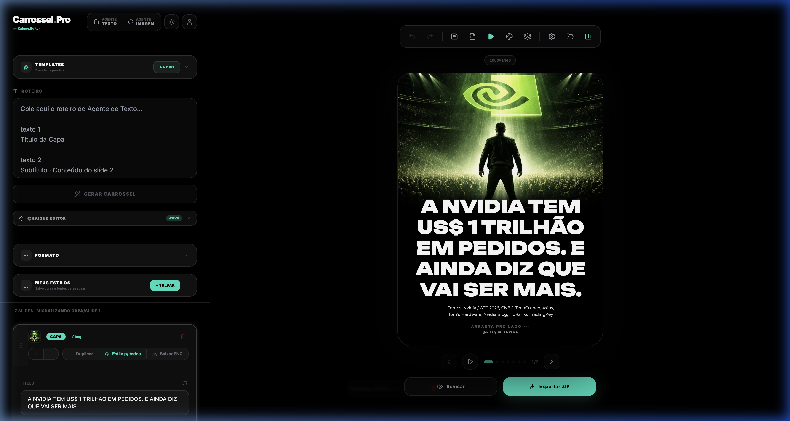
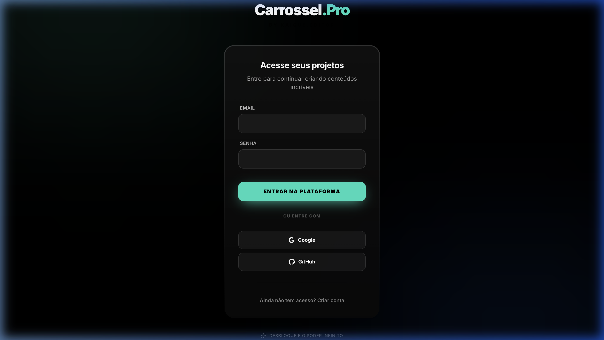

<div align="center">

# 🎠 Carrossel.Pro

### Editor de Carrossel Profissional com IA

**Crie carrosséis de alta performance em minutos.**
Editor visual completo, agentes de IA integrados e exportação em alta qualidade — tudo no navegador.

[](https://kaique-editor.vercel.app)
[](https://react.dev)
[](https://supabase.com)
[](https://vercel.com)

</div>

---

## 📸 Screenshots

<div align="center">

### Editor Desktop



> Layout de 2 colunas: **Sidebar** (roteiro, templates, formato, estilos) + **Canvas** (preview do slide em alta qualidade com controles de exportação)

---

### Editor Mobile


> Interface mobile-first com **Bottom Tab Bar**, preview fullscreen e toolbar compacta — edite direto do celular

---

### Login



> Autenticação com **Email/Senha**, **Google** ou **GitHub** — via Supabase

</div>

---

## ✨ Funcionalidades Principais

### 🎨 Editor Visual Completo

| Feature | Descrição |
| ------- | --------- |
| **2 Layouts** | Storytelling (imagem + texto) e Social Post (estilo Twitter/X) |
| **20+ Fontes profissionais** | Unbounded, Montserrat, Inter, Outfit, Bebas Neue, Playfair e mais |
| **Sistema de cores** | Fundo, título, corpo, branding — tudo customizável por slide |
| **Formatação rich text** | `*negrito*`, `_itálico_`, `~~tachado~~`, `==highlight==` |
| **Alinhamento** | Esquerda, centro, direita por slide individual |
| **Marca d'água** | `@seuinstagram` automático em todos os slides |
| **Drag & Drop** | Reordene slides arrastando, faça upload arrastando imagens |

### 🖼️ Controle Avançado de Imagem

- **Upload drag & drop** — Arraste fotos ou vídeos direto no slide
- **Posição focal X/Y** — Pad interativo para ajuste fino
- **Zoom** — De 1x até 4x com controle preciso
- **Escurecimento** — Overlay de 0% a 95% para contraste de texto
- **Área da imagem** — Controle quanto da tela a imagem ocupa
- **Suporte a vídeo** — Upload de MP4/MOV com trimming integrado

### 🤖 Agentes de IA Integrados

| Agente | O que faz |
| ------ | --------- |
| **Agente de Texto** | GPT especializado que gera roteiros virais para carrosséis |
| **Agente de Imagem** | GPT que gera imagens otimizadas para slides |
| **Processamento auto** | Cole o roteiro → o editor distribui automaticamente nos slides |
| **Variações de título** | Gere novas versões de headlines com IA (Gemini) |

### 📱 Mobile First

- **Bottom Tab Bar** nativa com 5 seções: Editor, Projetos, Preview, Criar, Ajustes
- **Canvas fullscreen** no celular — preview idêntico ao Instagram
- **Mini preview** inline dentro do editor de cada slide
- **Tema claro/escuro** — Alternância instantânea com animação suave
- **Criação sem IA** — Adicione e edite slides manualmente no celular

### 📦 Exportação Profissional

| Formato | Dimensão | Uso |
| ------- | -------- | --- |
| **Carrossel Instagram** | 1080×1440 (3:4) | Feed + Carrossel |
| **Stories / Reels** | 1080×1920 (9:16) | Stories e Reels |
| **Feed Quadrado** | 1080×1350 (4:5) | Posts de feed |
| **LinkedIn** | 1080×1080 (1:1) | Posts profissionais |

- **Download ZIP** — Todos os slides em PNG de alta qualidade
- **Export PDF** — Visualize e compartilhe como documento
- **Slides com vídeo** — Exportados automaticamente como `.mp4`
- **Preview Remotion** — Visualização animada com transições cinematográficas

### ☁️ Cloud Storage + Projetos

- **Auto-save** — Nunca perca seu trabalho
- **Sincronização Supabase** — Seus projetos vinculados ao seu email
- **Multi-dispositivo** — Comece no PC, continue no celular
- **Galeria de projetos** — Acesse e restaure carrosséis anteriores
- **Templates salvos** — Salve combinações de fonte/cor para reusar
- **Galeria de assets** — Busque imagens do Unsplash sem sair do editor

### 📊 Analytics (Admin)

- **Dashboard completo** — Total de usuários, carrosséis gerados, média por usuário
- **Ranking de usuários** — Quem mais criou, com filtro por período
- **Filtros de data** — Hoje, 7 dias, 30 dias, 60 dias ou todos
- **Acesso restrito** — Apenas perfis admin via Supabase RLS

### ⌨️ Atalhos de Teclado

| Atalho | Ação |
| ------ | ---- |
| `←` `→` | Navegar entre slides |
| `⌘Z` / `⌘⇧Z` | Undo / Redo |
| `⌘K` | Abrir Agente de Texto |
| `⌘⇧K` | Abrir Agente de Imagem |

---

## 🏗️ Arquitetura

```
┌─────────────────────────────────────────────────────────┐
│                    CARROSSEL.PRO                         │
├──────────┬──────────────────┬───────────────────────────┤
│ Frontend │   State Mgmt     │     Backend / Services    │
├──────────┼──────────────────┼───────────────────────────┤
│ React 19 │ Zustand          │ Supabase Auth (OAuth)     │
│ TypeScrip│ carouselSlice    │ Supabase Database (RLS)   │
│ Tailwind │ editorSlice      │ Supabase Storage          │
│ Vite 5   │ useHistory (undo)│ Gemini API (IA)           │
│          │                  │ Unsplash API (imagens)    │
├──────────┴──────────────────┴───────────────────────────┤
│                    Rendering Pipeline                    │
├─────────────────────────────────────────────────────────┤
│ html-to-image → PNG export                              │
│ JSZip → ZIP bundling                                    │
│ Remotion → Video preview + Animations                   │
│ jsPDF → PDF generation                                  │
└─────────────────────────────────────────────────────────┘
```

---

## 🔧 Stack Técnica

| Tecnologia | Uso | Versão |
| ---------- | --- | ------ |
| **React** | Interface reativa + Hooks | 19 |
| **TypeScript** | Tipagem estática | 5.x |
| **Zustand** | Gerenciamento de estado | 5.x |
| **Tailwind CSS** | Estilização utilitária | 3.x |
| **Vite** | Build tool + Dev server | 5.x |
| **Supabase** | Auth + Database + Storage | - |
| **Remotion** | Preview animado de vídeo | 4.x |
| **html-to-image** | Renderização de slides em PNG | - |
| **JSZip** | Compactação para download | - |
| **jsPDF** | Geração de PDF | - |
| **Lucide React** | Ícones vetoriais | - |
| **React Hot Toast** | Notificações | - |
| **Vercel** | Deploy e hosting | - |

---

## 🚀 Rodando Localmente

```bash
# Clone o repositório
git clone https://github.com/KaiqueEditor/kaique.editor.git

# Entre na pasta
cd kaique.editor

# Instale as dependências
npm install

# Configure as variáveis de ambiente
cp .env.example .env
# Edite o .env com suas chaves do Supabase e APIs

# Rode o servidor de desenvolvimento
npm run dev
```

Acesse **http://localhost:3001**

### Variáveis de Ambiente

```env
VITE_SUPABASE_URL=your_supabase_url
VITE_SUPABASE_ANON_KEY=your_supabase_anon_key
VITE_GEMINI_API_KEY=your_gemini_api_key
VITE_UNSPLASH_ACCESS_KEY=your_unsplash_key
```

---

## 📁 Estrutura do Projeto

```
src/
├── components/
│   ├── analytics/       # AnalyticsPage (dashboard admin)
│   ├── auth/            # LoginPage (Email, Google, GitHub)
│   ├── carousel/        # CarouselSlide + SlideFooter
│   ├── chat/            # AgentChat + ImageAgentChat
│   ├── editor/          # SlideEditor + VideoTrimModal
│   ├── export/          # ExportPreview (multi-formato)
│   ├── gallery/         # AssetGalleryModal (Unsplash)
│   ├── history/         # ProjectsGalleryModal
│   ├── layout/          # BottomTabBar (mobile nav)
│   ├── onboarding/      # Onboarding flow
│   ├── remotion/        # CarouselVideo + RemotionPreviewModal
│   ├── settings/        # SettingsModal
│   ├── templates/       # TemplateGallery (starter templates)
│   └── themes/          # CustomThemes (paletas)
├── hooks/
│   ├── useAdmin.ts      # Role-based access control
│   ├── useAutoSave.ts   # Auto-save com debounce
│   ├── useExport.ts     # PNG/ZIP/Video export
│   ├── useExportPDF.ts  # PDF generation
│   ├── useFileUpload.ts # Upload de imagem/vídeo
│   ├── useHistory.ts    # Undo/Redo stack
│   ├── useKeyboardShortcuts.ts
│   └── useProcessText.ts # Parser de roteiro → slides
├── services/
│   ├── api/             # GeminiService + UnsplashService
│   ├── processors/      # Image processing
│   └── storage/         # projectStorage (IndexedDB) + cloudStorage (Supabase)
├── store/               # Zustand store
│   └── slices/          # carouselSlice + editorSlice
├── constants/           # Tema, fontes (20+), cores, templates, atalhos
├── types/               # Section, ProjectConfig, ChatMessage
└── utils/               # Formatters, validation
```

---

## 🔐 Autenticação

| Método | Provider |
| ------ | -------- |
| Email + Senha | Supabase Auth |
| Google OAuth | Supabase + Google Cloud |
| GitHub OAuth | Supabase + GitHub Apps |

**Row Level Security (RLS)** — Cada usuário só acessa seus próprios carrosséis e configurações. Perfis admin são definidos via coluna `role` na tabela `profiles`.

---

## 📈 Roadmap

- [x] Editor visual completo com 2 layouts
- [x] Exportação multi-formato (Instagram, Stories, LinkedIn)
- [x] Autenticação OAuth (Google + GitHub)
- [x] Cloud storage com Supabase
- [x] Analytics dashboard (admin)
- [x] Mobile-first com Bottom Tab Bar
- [x] Preview animado com Remotion
- [x] Galeria de imagens Unsplash
- [x] Sistema de templates rápidos
- [x] Undo/Redo com atalhos
- [ ] Colaboração em tempo real
- [ ] Templates marketplace
- [ ] Integração direta com Instagram API
- [ ] Agendamento de postagens

---

## 👨‍💻 Autor

**Kaique Torres** — [@KaiqueEditor](https://github.com/KaiqueEditor)

---

<div align="center">

**Carrossel.Pro** — Transforme texto em carrosséis profissionais com IA ✨

[](https://kaique-editor.vercel.app)

</div>

---

## 📄 Licença

Projeto privado — © 2026 Kaique Torres. Todos os direitos reservados.
